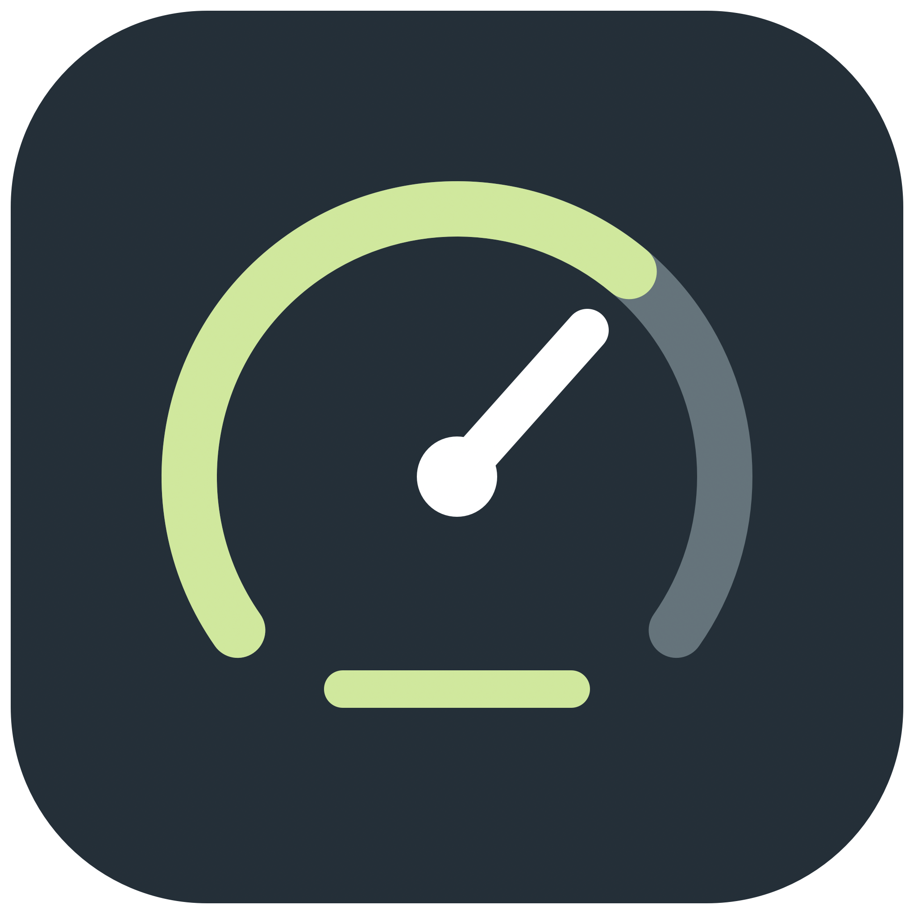

# Codex Limits



[Download the latest release](https://github.com/ar1gel/codex-limits/releases/latest)

Codex Limits is a small native macOS menu bar app that shows the remaining five-hour and weekly Codex usage limits, along with the five-hour reset time when Codex provides one. It refreshes every 60 seconds and marks the display when its data may be stale. If a value is unavailable, it stays unknown instead of being treated as zero.

The app reads quota data from the Codex app-server using its `initialize` and `account/rateLimits/read` methods. It does not inspect or print raw authentication data. You need to be signed in to Codex on the Mac where you run it.

## Requirements

- macOS 13 or later.
- A signed-in Codex installation. The app looks for the bundled CLI in ChatGPT.app, then Codex.app, and can use `codex` from `PATH`. Set `CODEX_CLI_PATH` to the CLI executable to select a specific installation.
- A Mac with Intel or Apple silicon. The release build is universal.

## Install

Download `Codex-Limits-1.0.0-universal.dmg` from the project’s GitHub release, open it, and drag **Codex Limits** into **Applications**. Open the app from Applications. It appears in the menu bar; it does not open a Dock window.

The release is ad-hoc signed and is not notarized with an Apple Developer ID. macOS Gatekeeper may block its first launch. If that happens, open **System Settings → Privacy & Security**, scroll to the security message for Codex Limits, and choose **Open Anyway**. macOS may ask you to confirm the launch. This is the standard Gatekeeper approval flow; do not remove quarantine attributes to bypass it.

Automatic launch at login is off by default. After moving the app into Applications, use **Запускать при входе в macOS** (Launch at Login) in the menu to enable it. macOS may require you to approve it in **System Settings → General → Login Items**.

## Build from source

Build on macOS with Xcode Command Line Tools installed:

```sh
./scripts/build.sh
```

The script builds a universal app and creates:

- `dist/Codex-Limits-1.0.0-universal.dmg`
- `dist/SHA256SUMS`

Run the quota parser self-test without a Codex account:

```sh
dist/'Codex Limits.app'/Contents/MacOS/CodexLimits --self-test
```

Check the app-server connection on a signed-in Mac:

```sh
dist/'Codex Limits.app'/Contents/MacOS/CodexLimits --probe
```

The probe requires an available Codex CLI and an authenticated Codex session. It prints the quota values it receives and exits with a nonzero status if the quota cannot be read.

## Data freshness

The app requests fresh quota data every minute and after the Mac wakes. If a request fails, it keeps the last known value marked as stale; before a first successful response, the value remains unknown. Reset time is shown only when Codex returns it. The app does not estimate quota from activity or infer a reset time.

The current menu labels are in Russian. The five-hour percentage remains visible without opening the menu; the weekly percentage is available in the menu.

## Project status

Codex Limits is an independent, community-built app. It is not an official OpenAI or Codex app, and it does not bundle OpenAI logos or Codex binaries. The app depends on the Codex app-server protocol and on a signed-in Codex installation being available locally.

## License

MIT. See [LICENSE](LICENSE).
